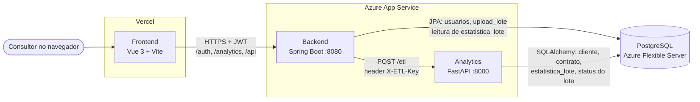
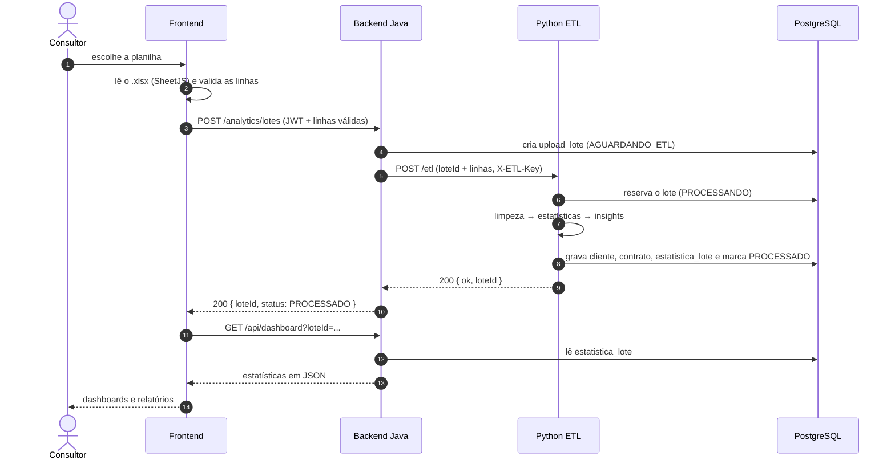

# CTI Insights (InCTI)

Plataforma web que transforma planilhas de clientes de consultoria em indicadores estatísticos e dashboards.

O consultor faz login, envia uma planilha `.xlsx`/`.xls`/`.csv`, o sistema limpa e padroniza os dados, calcula estatísticas (média, mediana, desvio padrão, quartis, correlação etc.) e mostra o resultado em gráficos e relatórios.

## Camadas do projeto

| Pasta | Camada | Tecnologia | Papel | Documentação |
|---|---|---|---|---|
| [`frontend/`](frontend/) | Interface | Vue 3 + Vite | Telas, leitura e pré-validação da planilha, dashboards | [frontend/README.md](frontend/README.md) |
| [`backend/`](backend/) | API principal | Java 21 + Spring Boot | Autenticação (JWT), validação no servidor, orquestração do ETL, leitura dos resultados | [backend/README.md](backend/README.md) |
| [`analytics-python/`](analytics-python/) | Ciência de dados | Python + FastAPI + pandas | Limpeza, padronização, estatísticas, insights e gravação dos dados analíticos | [analytics-python/README.md](analytics-python/README.md) |

Arquivos na raiz:

- [`iniciar.ps1`](iniciar.ps1): sobe Python, backend e frontend localmente, cada um em uma janela.

## Arquitetura

O frontend fala **somente** com o backend Java. O backend é o único que chama o serviço Python. Java e Python acessam o mesmo banco PostgreSQL, cada um com sua responsabilidade.



### Fluxo de um upload



### Quem grava o quê no banco

| Tabela | Escrita por | Conteúdo |
|---|---|---|
| `usuarios` | Backend | contas (senha com hash BCrypt) e perfil `USUARIO`/`ADMIN` |
| `upload_lote` | Backend cria; Python atualiza o status | controle de cada envio: arquivo, contagens, status, mensagem |
| `cliente`, `contrato` | Python | dados tratados de cada lote |
| `estatistica_lote` | Python | resultado completo da análise em JSON (`jsonb`) |

As tabelas são criadas pelo Hibernate (`spring.jpa.hibernate.ddl-auto=update`) quando o backend sobe pela primeira vez. Por isso o backend precisa ter subido ao menos uma vez antes do primeiro upload.

## URLs de produção

| Serviço | URL |
|---|---|
| Frontend (Vercel) | https://in-cti-full-stack.vercel.app |
| Backend | https://cti-api-incti.azurewebsites.net (health: [`/api/health`](https://cti-api-incti.azurewebsites.net/api/health)) |
| Python | https://cti-etl-incti.azurewebsites.net (health: [`/saude`](https://cti-etl-incti.azurewebsites.net/saude), docs: [`/docs`](https://cti-etl-incti.azurewebsites.net/docs)) |

> Os serviços estão no plano gratuito (F1) da Azure. Se ficarem muito tempo sem uso, a primeira requisição pode demorar enquanto o app "acorda".

## Como rodar localmente

### Pré-requisitos

- PostgreSQL acessível (local na porta 5432 ou o servidor da Azure)
- Python 3.12+
- Java 21+ (o Maven Wrapper já vem no projeto)
- Node.js 20+ e npm

### Ordem de execução

Suba nesta ordem, cada um em um terminal:

1. **Banco de dados**: garanta que o PostgreSQL está no ar.
2. **Python** (porta 8000):
   ```bash
   cd analytics-python
   python -m venv .venv
   .venv\Scripts\activate        # Linux/macOS: source .venv/bin/activate
   pip install -r requirements.txt
   copy .env.example .env        # Linux/macOS: cp .env.example .env  → preencha
   python -m uvicorn api:app --reload --port 8000
   ```
3. **Backend** (porta 8080):
   ```bash
   cd backend
   .\mvnw.cmd spring-boot:run    # Linux/macOS: ./mvnw spring-boot:run
   ```
   Com o banco da Azure, use `.\run-local.ps1`, que define as variáveis e pede a senha.
4. **Frontend** (porta 5173):
   ```bash
   cd frontend
   npm install
   npm run dev
   ```

Abra http://localhost:5173.

No Windows, depois de instalar as dependências uma vez, o atalho `.\iniciar.ps1` (na raiz) abre os três serviços na ordem certa.

### Variáveis de ambiente (resumo)

| Variável | Onde | Para quê |
|---|---|---|
| `DB_URL` ou `DB_HOST`/`DB_PORT`/`DB_NAME`/`DB_SSLMODE` | backend | conexão com o PostgreSQL |
| `DB_HOST`, `DB_PORT`, `DB_NAME`, `DB_SSLMODE` | python | conexão com o PostgreSQL |
| `DB_USER`, `DB_PASSWORD` | ambos | credenciais do banco |
| `JWT_SECRET` | backend | assinatura dos tokens |
| `CORS_ORIGINS` | backend | origens do frontend permitidas (separadas por vírgula) |
| `ETL_URL` | backend | endereço do serviço Python |
| `ETL_KEY` (backend) = `ETL_API_KEY` (python) | ambos | chave compartilhada; se forem diferentes, o Python responde 401 |
| `ADMIN_EMAIL`, `ADMIN_PASSWORD` | backend | cria o usuário administrador na primeira subida |
| `VITE_API_URL` | frontend | URL do backend |

Os detalhes de cada variável estão no README de cada camada. Senhas e chaves ficam em `.env` (ignorado pelo Git) ou nas configurações da Azure/Vercel, nunca no código.

## Estrutura do repositório

```text
InCTI/
├── analytics-python/      # ETL e estatísticas (FastAPI)
├── backend/               # API REST (Spring Boot)
├── frontend/              # SPA (Vue 3)
├── iniciar.ps1            # sobe tudo localmente
└── README.md              # este arquivo
```
