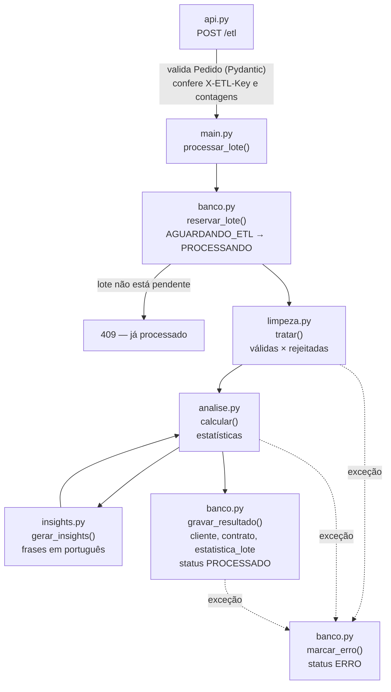

# CTI Insights — Analytics (Python)

Serviço de ciência de dados do CTI Insights. Ele recebe do backend as linhas da planilha, faz a limpeza e a padronização, calcula as estatísticas, gera insights em português e grava tudo no PostgreSQL.

> Voltar para o [README geral](../README.md)

## Stack

| Biblioteca | Uso |
|---|---|
| **FastAPI** | API HTTP (`api.py`) e documentação automática |
| **Uvicorn** | servidor ASGI que executa o FastAPI |
| **Pydantic** | validação do corpo das requisições (`Pedido`) |
| **pandas** | tabela de dados, limpeza, agrupamentos e quartis |
| **NumPy** | base numérica do pandas/SciPy |
| **SciPy** | correlação de Pearson e Spearman (`scipy.stats`) |
| **SQLAlchemy** | conexão e transações com o PostgreSQL |
| **psycopg** (v3, `psycopg[binary]`) | driver PostgreSQL usado pelo SQLAlchemy |
| **python-dotenv** | lê o arquivo `.env` em desenvolvimento |

## URLs

| | Produção | Local |
|---|---|---|
| Base | https://cti-etl-incti.azurewebsites.net | http://localhost:8000 |
| Health check | [`/saude`](https://cti-etl-incti.azurewebsites.net/saude) → `{"status":"ok"}` | http://localhost:8000/saude |
| Swagger UI | [`/docs`](https://cti-etl-incti.azurewebsites.net/docs) | http://localhost:8000/docs |
| ReDoc | [`/redoc`](https://cti-etl-incti.azurewebsites.net/redoc) | http://localhost:8000/redoc |

## Endpoints

| Método | Rota | Quem chama | Descrição |
|---|---|---|---|
| GET | `/saude` | monitoramento | health check |
| POST | `/etl` | backend Java | processa um lote: limpa, analisa e grava |
| POST | `/testar` | desenvolvedor | roda limpeza e análise sobre uma lista de linhas **sem gravar** no banco |
| GET | `/lotes` | desenvolvedor | lista os lotes (`id`, `arquivo_nome`, `status`) |

Quando a variável `ETL_API_KEY` está definida, todas as rotas exceto `/saude` exigem o header `X-ETL-Key` com o mesmo valor. Sem ele, a resposta é **401**. Assim, só o backend consegue disparar o ETL.

Corpo de `POST /etl`:

```json
{
  "arquivoNome": "clientes.xlsx",
  "loteId": 42,
  "recebidas": 3,
  "invalidas": 1,
  "comAviso": 0,
  "linhas": [ { "codigo_cliente": "C001", "nome_cliente": "...", "faturamento_anual": "1.250.000,50" } ]
}
```

Respostas: `200 {"ok": true, "status": "PROCESSADO", "loteId": 42}` · `422` se `recebidas ≠ len(linhas) + invalidas` · `409` se o lote não existe, já foi processado ou falhou na análise (com a mensagem em `detail`).

## Pipeline de um lote



| Arquivo | Responsabilidade |
|---|---|
| [`api.py`](api.py) | rotas FastAPI, modelo `Pedido`, verificação da chave `X-ETL-Key` |
| [`main.py`](main.py) | orquestra o lote: reserva → limpa → analisa → grava; em caso de erro, marca `ERRO` |
| [`limpeza.py`](limpeza.py) | normaliza colunas e valores e separa linhas válidas das rejeitadas |
| [`analise.py`](analise.py) | estatísticas gerais, por grupo, por mês, por serviço e correlação |
| [`insights.py`](insights.py) | transforma os números em frases (formato R$ brasileiro) |
| [`banco.py`](banco.py) | engine SQLAlchemy, reserva, gravação transacional e marcação de erro |
| [`config.py`](config.py) | monta a URL de conexão a partir das variáveis `DB_*` |
| [`testar_conexao.py`](testar_conexao.py) | script para testar a conexão com o banco |

### Controle do lote

O lote é criado pelo backend com status `AGUARDANDO_ETL`. O Python só aceita lotes nesse status e os troca para `PROCESSANDO` em um único `UPDATE ... WHERE status = 'AGUARDANDO_ETL'`. Por isso, o mesmo lote não é processado duas vezes, nem com requisições simultâneas.

A gravação acontece **numa única transação** (`engine.begin()`): ou entram todos os clientes, contratos e estatísticas e o lote vira `PROCESSADO`, ou nada é gravado e o lote vira `ERRO` com a mensagem do problema.

## Limpeza e padronização (`limpeza.py`)

### Colunas

Os nomes das colunas são convertidos para `snake_case` sem acento. Por isso, planilhas com cabeçalhos diferentes funcionam:

| Antes | Depois |
|---|---|
| `Código Cliente`, `codigoCliente`, `Codigo_Cliente` | `codigo_cliente` |
| `Faturamento Anual` | `faturamento_anual` |
| `UF` | `uf` |

Colunas esperadas que estiverem ausentes são criadas vazias: `codigo_cliente`, `nome_cliente`, `consultor`, `segmento`, `nivel_cliente`, `faturamento_anual`, `servicos_contratados`, `data_contratacao`, `cidade` e `uf`.

### Valores

| Campo | Regra | Antes | Depois |
|---|---|---|---|
| todos os textos | remove espaços no início/fim e espaços repetidos | `"  C001 "`, `"maria  da silva"` | `"C001"`, `"maria da silva"` |
| `nome_cliente`, `consultor`, `cidade` | capitalização de nome próprio (`str.title()`) | `"maria da silva"`, `"são paulo"` | `"Maria Da Silva"`, `"São Paulo"` |
| `uf`, `nivel_cliente` | maiúsculas | `"sp"`, `"a"` | `"SP"`, `"A"` |
| `faturamento_anual` | aceita formato brasileiro, `R$` e ponto de milhar | `"R$ 1.250.000,50"`, `"980000"` | `1250000.5`, `980000.0` |
| `segmento` | sinônimos (ignorando acento, maiúsculas e ponto) → nome padrão | `"IND."`, `"industria"`, `"comercial"`, `"servico"`, `"saude"` | `"Indústria"`, `"Indústria"`, `"Comércio"`, `"Serviços"`, `"Saúde"` |
| `data_contratacao` | número serial do Excel ou texto → ISO `AAAA-MM-DD`; data inválida vira vazia | `45292`, `"2024-03-15"` | `"2024-01-01"`, `"2024-03-15"` |
| `servicos_contratados` | separa por `;`, `,` ou `\|`, capitaliza e mantém siglas que já vêm em maiúsculas (até 4 letras) | `"consultoria; ERP \| CRM"` | `["Consultoria", "ERP", "CRM"]` |
| colunas derivadas | `servicos` (lista), `qtd_servicos`, `mes` (`AAAA-MM`) | — | `qtd_servicos = 3`, `mes = "2024-01"` |

Tabela completa de sinônimos de segmento:

| Chave normalizada | Segmento |
|---|---|
| `ind`, `industria` | Indústria |
| `comercio`, `comercial` | Comércio |
| `servicos`, `servico` | Serviços |
| `saude` | Saúde |
| `educacao` | Educação |
| `tecnologia` | Tecnologia |
| outro valor | mantido, com a primeira letra de cada palavra maiúscula |

> **Limitações conhecidas:** a capitalização usa `str.title()`, então preposições também ficam maiúsculas ("Maria **Da** Silva"). Siglas de serviço que chegam em minúsculas também são capitalizadas ("erp" → "Erp"); só as que já vêm em maiúsculas são preservadas.

### Regras de descarte

Uma linha é **rejeitada** (vai para `rejeitadas`, com `motivo_rejeicao`) se:

- `codigo_cliente` estiver vazio, **ou**
- `nome_cliente` estiver vazio, **ou**
- `faturamento_anual` não puder ser convertido em número (ex.: `"abc"`, vazio).

As linhas rejeitadas não são gravadas e entram na contagem `linhasInvalidas` do relatório de qualidade. Todos os outros campos são opcionais: se faltarem, ficam vazios, mas a linha continua.

Exemplo real (saída de `tratar()`):

| Entrada | Resultado |
|---|---|
| `{"Código Cliente": "  C001 ", "Nome Cliente": "maria  da silva", "Segmento": "IND.", "Nivel Cliente": "a", "Faturamento Anual": "R$ 1.250.000,50", "Servicos Contratados": "consultoria bi; erp \| CRM", "Data Contratacao": 45292, "Cidade": "são paulo", "UF": "sp"}` | `{"codigo_cliente": "C001", "nome_cliente": "Maria Da Silva", "segmento": "Indústria", "nivel_cliente": "A", "faturamento_anual": 1250000.5, "servicos": ["Consultoria Bi", "Erp", "CRM"], "data_contratacao": "2024-01-01", "mes": "2024-01", "cidade": "São Paulo", "uf": "SP"}` |
| `{"Código Cliente": "C003", "Nome Cliente": "", "Faturamento Anual": "100"}` | rejeitada: *Código, nome ou faturamento inválido.* |
| `{"Código Cliente": "C004", "Nome Cliente": "Beta", "Faturamento Anual": "abc"}` | rejeitada: *Código, nome ou faturamento inválido.* |

## Análise estatística (`analise.py`)

Todas as medidas são calculadas sobre `faturamento_anual` das linhas válidas.

| Medida | Como é calculada | Campo no JSON |
|---|---|---|
| Total | soma | `faturamentoTotal` |
| Média | `serie.mean()` | `media` |
| Mediana | `serie.median()` | `mediana` |
| Desvio padrão (amostral) | `serie.std(ddof=1)`; vazio se houver só 1 cliente | `desvioPadrao` |
| Mínimo e máximo | `min()` / `max()` | `minimo`, `maximo` |
| Amplitude | `maximo − minimo` (derivada dos dois campos acima) | — |
| Quartis | `quantile(0.25)` e `quantile(0.75)` | `q1`, `q3` |
| Coeficiente de variação | `desvioPadrao / media` (3 casas) | `coeficienteVariacao` |
| Moda | valor mais frequente de segmento, nível e serviço | `segmentoMaisFrequente`, `nivelMaisFrequente`, `servicoMaisContratado` |
| Correlação | Pearson e Spearman entre `qtd_servicos` e faturamento (mín. 3 clientes), com p-valor e interpretação (fraca < 0,4 ≤ moderada < 0,7 ≤ forte) | `correlacao` |

Também calcula, para cada **segmento**, **nível** e **consultor**: clientes, % de clientes, % do faturamento, total, média, mediana, desvio, mínimo e máximo. Calcula ainda a contagem de clientes por **serviço**, a série **mensal** (com meses sem contratação preenchidos com zero e o acumulado) e o **top 5** clientes por faturamento.

Estrutura do resultado gravado em `estatistica_lote.resultado` (jsonb) e entregue ao frontend:

```text
{ geradoEm, resumo, porSegmento, porNivel, porConsultor, porServico,
  porMes, correlacao, topClientes, qualidade, insights }
```

Exemplo de `resumo` para os 2 clientes válidos do exemplo acima:

```json
{
  "totalClientes": 2, "faturamentoTotal": 2230000.5,
  "media": 1115000.25, "mediana": 1115000.25, "desvioPadrao": 190919.18,
  "minimo": 980000.0, "maximo": 1250000.5, "q1": 1047500.12, "q3": 1182500.38,
  "coeficienteVariacao": 0.171, "mediaServicosPorCliente": 2.0, "consultores": 2
}
```

`qualidade` informa linhas recebidas, válidas e inválidas, e quantas correções foram feitas em segmento, consultor e nível, com os segmentos originais.

### Insights (`insights.py`)

Frases geradas a partir dos números, por exemplo:

- "O segmento Indústria concentra a maior carteira: 40 clientes (33,3%)."
- "A média de faturamento (R$ 1.300.000,00) é maior que a mediana (R$ 900.000,00): poucos clientes muito grandes puxam a média para cima, então a mediana descreve melhor o cliente típico." (quando a média passa 10% da mediana)

## Banco de dados

| Tabela | Operação |
|---|---|
| `upload_lote` | `UPDATE` de status (`PROCESSANDO` → `PROCESSADO`/`ERRO`), contagens e mensagem |
| `cliente` | `INSERT` de cada cliente válido, ligado ao `lote_id` |
| `contrato` | `INSERT` de um registro por serviço do cliente |
| `estatistica_lote` | `INSERT` do JSON da análise (substitui uma análise anterior do mesmo lote) |

As tabelas são criadas pelo backend (Hibernate). Se o Python subir antes, tudo bem: ele só acessa as tabelas quando recebe um lote.

## Como rodar

Pré-requisitos: Python 3.12+ e acesso ao PostgreSQL.

```bash
cd analytics-python
python -m venv .venv
.venv\Scripts\activate              # Linux/macOS: source .venv/bin/activate
pip install -r requirements.txt
copy .env.example .env              # Linux/macOS: cp .env.example .env
python testar_conexao.py            # confere a conexão com o banco
python -m uvicorn api:app --reload --port 8000
```

Acesse http://localhost:8000/docs para testar as rotas pelo navegador.

### Variáveis de ambiente (`.env`)

| Variável | Exemplo | Descrição |
|---|---|---|
| `DB_HOST` | `localhost` ou `incti.postgres.database.azure.com` | servidor PostgreSQL |
| `DB_PORT` | `5432` | porta |
| `DB_NAME` | `incti` / `postgres` | base de dados |
| `DB_USER` | `postgres` | usuário |
| `DB_PASSWORD` | — | senha |
| `DB_SSLMODE` | `prefer` (local) / `require` (Azure) | modo SSL |
| `ETL_API_KEY` | texto longo aleatório | chave exigida no header `X-ETL-Key`; igual ao `ETL_KEY` do backend |

O `.env` está no `.gitignore`. Só o `.env.example` (sem valores) vai para o repositório.

## Deploy (Azure App Service)

- Runtime: **Python 3.12**, Linux.
- Comando de inicialização: `python -m uvicorn api:app --host 0.0.0.0 --port 8000`
- Variáveis: as da tabela acima, mais `SCM_DO_BUILD_DURING_DEPLOYMENT=true`, para a Azure instalar o `requirements.txt`.
- Publicação com Azure CLI (zip com os `.py` e o `requirements.txt`, sem `.venv` e `.env`):
  ```bash
  az webapp deploy -g Incti -n cti-etl-incti --src-path python.zip --type zip
  ```
