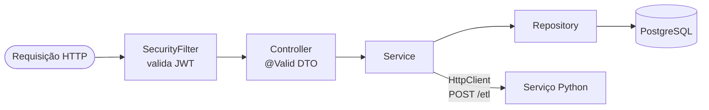
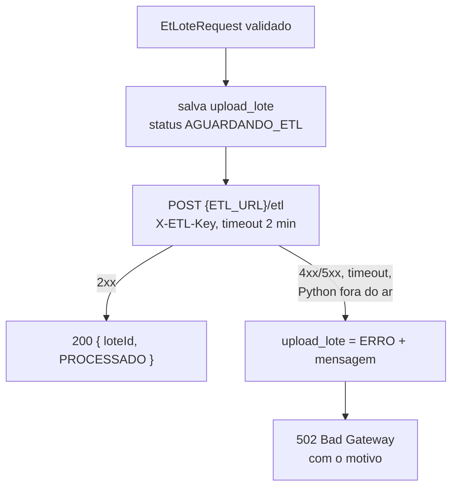

# CTI Insights — Backend (Java)

API REST do CTI Insights. Ela autentica usuários, valida tudo o que chega do cliente, cria os lotes de upload, chama o serviço Python para o ETL e entrega os resultados ao frontend.

> Voltar para o [README geral](../README.md)

## Stack

| Tecnologia | Versão | Uso |
|---|---|---|
| Java | 21 | linguagem (records, pattern matching) |
| Spring Boot | 4.1.1 | base da aplicação (`spring-boot-starter-parent`) |
| Spring Web MVC | — | controllers REST |
| Spring Security | — | filtro JWT, rotas públicas e privadas, CORS |
| Spring Data JPA / Hibernate | — | repositórios e criação das tabelas (`ddl-auto=update`) |
| Bean Validation | — | `@Valid`, `@NotBlank`, `@Email`, `@Pattern`, `@NotEmpty` nos DTOs |
| Auth0 `java-jwt` | 4.5.0 | geração e validação de tokens JWT (HMAC256) |
| BCrypt (Spring Security Crypto) | — | hash de senhas |
| PostgreSQL JDBC | — | driver do banco |
| `java.net.http.HttpClient` | JDK | chamada HTTP ao serviço Python |
| Maven Wrapper | — | build (`mvnw` / `mvnw.cmd`) |

**URL de produção:** https://cti-api-incti.azurewebsites.net
**Health check:** [`GET /api/health`](https://cti-api-incti.azurewebsites.net/api/health) → `{"status":"ok"}`

## Funções desta camada

1. **Autenticação e autorização**: cadastro e login com senha em hash **BCrypt** e emissão de **JWT** (validade de 120 min). Todas as rotas, menos health, login e cadastro, exigem `Authorization: Bearer <token>`.
2. **Validação no servidor**: os DTOs são validados com Bean Validation antes de chegar no service.
3. **Orquestração do ETL**: recebe as linhas válidas do frontend, registra o lote e chama o Python (`POST {ETL_URL}/etl`) com a chave `X-ETL-Key`.
4. **Entrega dos resultados**: lê a análise gravada pelo Python (`estatistica_lote`) e devolve ao frontend.

### Regra de ouro: *never trust the client*

Tudo o que vem do navegador é tratado como não confiável, mesmo que o frontend já tenha validado:

- **Senha**: o regex de força é checado no DTO (`@Pattern` em `RegisterRequest`) e de novo no `UsuarioService`.
- **E-mail duplicado**: o service verifica antes de gravar, e a coluna tem `unique = true`. Duplicado retorna **409**.
- **Identidade**: o usuário vem do **token validado** (`SecurityFilter`), nunca de um campo do corpo da requisição.
- **Lote**: `@NotEmpty` nas linhas. O Python ainda refaz a limpeza e confere que `recebidas = linhas + invalidas`.
- **Perfil**: todo cadastro público nasce como `USUARIO`. O `ADMIN` só é criado pelo `AdminSeeder`, a partir de variáveis de ambiente.

### O que o backend grava

O backend grava **só** os dados de conta e de controle:

- `usuarios`: contas e perfis;
- `upload_lote`: registro de cada envio, criado com status `AGUARDANDO_ETL`, ou `ERRO` se o Python falhar.

Os **dados analíticos** (`cliente`, `contrato`, `estatistica_lote`) são gravados **somente pelo serviço Python**. O backend apenas lê `estatistica_lote` para montar o dashboard. Assim fica claro quem é dono de cada dado.

## Endpoints

### Públicos

| Método | Rota | Descrição | Respostas |
|---|---|---|---|
| GET | `/api/health` | health check | 200 `{"status":"ok"}` |
| POST | `/auth/register` | cria usuário (`nomeCompleto`, `email`, `senha`) | 201 usuário · 400 validação · 409 e-mail já cadastrado |
| POST | `/auth/login` | autentica (`email`, `senha`) | 200 `{"token","nome"}` · 401 credenciais inválidas |

### Autenticados (Bearer token)

| Método | Rota | Descrição |
|---|---|---|
| GET | `/auth/me` | dados do usuário logado (`id`, `nomeCompleto`, `email`, `perfil`) |
| POST | `/analytics/lotes` | envia as linhas para análise. Cria o lote, chama o Python e retorna `{loteId, status, mensagem}`; se o Python falhar, retorna **502** com o motivo |
| GET | `/analytics/dashboard?loteId=` | JSON bruto da análise de um lote |
| GET | `/api/dashboard` | lote + análise do último lote `PROCESSADO`; aceita `?loteId=` |
| GET | `/api/dashboard/lotes` | últimos 20 lotes (id, arquivo, status, contagens, data) |

### Exemplos

```http
POST /auth/login
Content-Type: application/json

{ "email": "ana@empresa.com", "senha": "Senha@123" }
```

```json
{ "token": "eyJhbGciOiJIUzI1NiJ9...", "nome": "Ana Beatriz" }
```

```http
POST /analytics/lotes
Authorization: Bearer eyJhbGciOi...
Content-Type: application/json

{
  "arquivoNome": "clientes.xlsx",
  "recebidas": 3,
  "invalidas": 1,
  "comAviso": 0,
  "linhas": [
    { "codigo_cliente": "C001", "nome_cliente": "Empresa A", "faturamento_anual": 1250000, "segmento": "Indústria" },
    { "codigo_cliente": "C002", "nome_cliente": "Empresa B", "faturamento_anual": 980000, "segmento": "Comércio" }
  ]
}
```

```json
{ "loteId": 42, "status": "PROCESSADO", "mensagem": "Análise concluída." }
```

## Arquitetura

### Pacotes

```text
backend/src/main/java/com/incti/backend/
├── BackendApplication.java   # ponto de entrada
├── config/                   # SecurityConfig, SecurityFilter (JWT), AdminSeeder
├── controller/               # camada HTTP: recebe, valida (@Valid) e responde
├── service/                  # regras de negócio, JWT, chamada ao Python
├── repository/               # interfaces Spring Data JPA
├── model/                    # entidades JPA (tabelas)
└── dto/                      # records de entrada e saída da API
```

### Fluxo de uma requisição



Fluxo do upload (`POST /analytics/lotes`) dentro do `PythonEtlService`:



### Boas práticas aplicadas

- **Injeção de dependência por construtor**: todos os controllers, services e o filtro recebem as dependências no construtor, em campos `final`. Não há `@Autowired` em campo, o que facilita testar e deixa as dependências explícitas.
- **DTOs com `record`**: `LoginRequest`, `LoginResponse`, `RegisterRequest`, `UsuarioResponse`, `EtLoteRequest` e `LoteResponse` são records imutáveis. A entidade `Usuario`, com a senha, nunca é devolvida diretamente: a resposta usa `UsuarioResponse`.
- **API stateless**: sem sessão no servidor (`SessionCreationPolicy.STATELESS`), CSRF desativado (não há cookie de sessão) e CORS restrito às origens de `CORS_ORIGINS`.
- **Tratamento de erros**: os erros de negócio são lançados como `ResponseStatusException`, com status e mensagem certos (404 sem lote, 502 falha no Python, 500 JSON inválido). O `AuthController` converte `BadCredentialsException` → 401 e `IllegalStateException` → 409 com `@ExceptionHandler`. Erros de Bean Validation viram **400**. Com `server.error.include-message=always`, todos chegam ao frontend no formato padrão do Spring (`{status, error, message}`), que o `api.js` transforma em texto para o usuário. O dispatch de `/error` é liberado no Spring Security para que um 404/502 não vire 401.

### Mapa de classes

| Domínio | Controller | Service | Repository | Model / DTO |
|---|---|---|---|---|
| Autenticação | `AuthController` | `AutenticacaoService`, `UsuarioService`, `TokenService` | `UsuarioRepository` | `Usuario`, `Perfil` · `LoginRequest`, `LoginResponse`, `RegisterRequest`, `UsuarioResponse` |
| Segurança | — | — | — | `config/SecurityConfig`, `config/SecurityFilter`, `config/AdminSeeder` |
| ETL / lotes | `AnalyticsController` | `PythonEtlService` | `UploadLoteRepository`, `EstatisticaLoteRepository` | `UploadLote`, `EstatisticaLote` · `EtLoteRequest`, `LoteResponse` |
| Dashboard | `DashboardController` | `DashboardService` | `UploadLoteRepository`, `EstatisticaLoteRepository` | — |
| Saúde | `HealthController` | — | — | — |
| Tabelas do Python | — | — | — | `ClienteAnalytics` (`cliente`), `ContratoAnalytics` (`contrato`): mapeadas só para o Hibernate criar as tabelas |

## Configuração

Todas as configurações ficam em [`application.properties`](src/main/resources/application.properties) e são lidas de **variáveis de ambiente**. O valor depois de `:` é o padrão para rodar localmente.

| Variável | Padrão local | Descrição |
|---|---|---|
| `DB_URL` | montada a partir de `DB_HOST`, `DB_PORT`, `DB_NAME`, `DB_SSLMODE` | JDBC completo, ex.: `jdbc:postgresql://servidor:5432/postgres?sslmode=require` |
| `DB_HOST` / `DB_PORT` / `DB_NAME` / `DB_SSLMODE` | `localhost` / `5432` / `incti` / `prefer` | usadas quando `DB_URL` não existe |
| `DB_USER` / `DB_PASSWORD` | `postgres` / — | credenciais |
| `JWT_SECRET` | chave de teste | segredo do JWT. **Em produção use uma chave longa e aleatória** |
| `CORS_ORIGINS` | `http://localhost:5173` | origens permitidas, separadas por vírgula |
| `ETL_URL` | `http://localhost:8000` | URL do Python (com ou sem `/etl` no fim) |
| `ETL_KEY` | chave local | precisa ser igual a `ETL_API_KEY` do Python |
| `ADMIN_EMAIL` / `ADMIN_PASSWORD` | — | se definidas, criam o administrador na primeira subida |
| `PORT` | `8080` | porta HTTP (na Azure o próprio App Service define) |

## Como rodar

Pré-requisitos: Java 21+ e um PostgreSQL acessível. O Python deve estar rodando para o upload funcionar (veja a [ordem no README geral](../README.md#ordem-de-execução)).

```bash
cd backend
.\mvnw.cmd spring-boot:run          # Windows
./mvnw spring-boot:run              # Linux/macOS
```

Usando o banco da Azure no Windows, rode `.\run-local.ps1`. Ele define as variáveis, pede a senha do banco sem mostrá-la e sobe a aplicação.

Na primeira subida, o Hibernate cria as tabelas. Teste com:

```bash
curl http://localhost:8080/api/health
```

Gerar o `.jar`:

```bash
.\mvnw.cmd -DskipTests package     # backend/target/backend-0.0.1-SNAPSHOT.jar
java -jar target/backend-0.0.1-SNAPSHOT.jar
```

## Deploy (Azure App Service)

- Runtime: **Java 21 (Java SE)**, Linux.
- Publicação manual com Azure CLI:
  ```bash
  ./mvnw -DskipTests package
  az webapp deploy -g Incti -n cti-api-incti --src-path target/backend-0.0.1-SNAPSHOT.jar --type jar
  ```
- Variáveis de produção: as da tabela de configuração, em *Configurações → Variáveis de ambiente* do App Service.
- No firewall do PostgreSQL, deixe ligada a opção "Permitir acesso de serviços do Azure".

## Problemas comuns

| Sintoma | Causa provável |
|---|---|
| Upload retorna **502** "O serviço Python não está rodando" | Python fora do ar ou `ETL_URL` errado |
| Upload retorna **502** "Chave ETL inválida" | `ETL_KEY` diferente de `ETL_API_KEY` do Python |
| Erro de CORS no navegador | URL do frontend ausente em `CORS_ORIGINS` |
| **401** em todas as rotas | token expirado (120 min) ou `JWT_SECRET` mudou; faça login de novo |
| Falha ao subir: conexão com o banco | `DB_*` errados ou IP não liberado no firewall do PostgreSQL |
