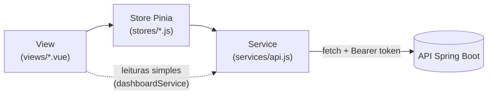

# CTI Insights — Frontend

Interface web do CTI Insights: login e cadastro, leitura e validação de planilhas, envio para análise e dashboards com os resultados.

> Voltar para o [README geral](../README.md)

## Stack

| Tecnologia | Uso no projeto |
|---|---|
| **Vue 3** (Composition API, `<script setup>`) | componentes e telas |
| **Vite 6** | servidor de desenvolvimento e build |
| **Vue Router 4** | rotas e proteção das páginas logadas |
| **Pinia** | estado centralizado (`authStore`, `uploadStore`) |
| **Tailwind CSS 4** | estilos utilitários (via `@tailwindcss/vite`) |
| **Chart.js 4** | gráficos dos dashboards (componente `BaseChart`) |
| **SheetJS (`xlsx`)** | leitura de `.xlsx`, `.xls` e `.csv` no navegador |
| **Fetch API** | chamadas HTTP, centralizadas em `src/services/api.js` |

> O projeto usa a Fetch API nativa em vez de Axios: toda chamada HTTP passa pela função de `services/api.js`, que cumpre o mesmo papel de um cliente Axios configurado (URL base, token e tratamento de erros).

**URL de produção (Vercel):** https://in-cti-full-stack.vercel.app

## O que esta camada faz

1. **Login e cadastro**: telas `/login` e `/cadastro`. O cadastro mostra em tempo real os requisitos da senha (8+ caracteres, maiúscula, minúscula, número e caractere especial). O login guarda o token JWT devolvido pelo backend.
2. **Leitura do arquivo**: o arquivo é lido **no navegador** com SheetJS. Só a primeira aba é usada e a linha 1 é o cabeçalho.
3. **Validação e tratamento prévio**: remove espaços extras, padroniza segmento e nível, converte datas numéricas do Excel e aponta erros por linha.
4. **Envio das linhas válidas**: só as linhas sem erro bloqueante vão para o backend (`POST /analytics/lotes`).
5. **Dashboards**: resumo com gráficos (`/dashboard`) e relatório detalhado (`/dashboard/relatorios`), com seleção entre os últimos lotes processados.
6. **Gestão da conta**: cadastro de usuário, página "Meu perfil" (`/dashboard/perfil`) e logout. Os dados extras do perfil (cargo, setor, telefone, foto) ficam salvos só no navegador (`localStorage`).

### O frontend não acessa o banco

O frontend **nunca** se conecta ao PostgreSQL. Ele só conversa com o backend por HTTP. Assim, as credenciais do banco ficam só no servidor e toda regra de segurança fica do lado do backend. O navegador do usuário, que qualquer pessoa pode inspecionar ou alterar, nunca recebe essas credenciais.

### Por que validar no front (e por que isso não basta)

A validação no navegador existe pela **usabilidade**:

- o usuário vê na hora quais linhas têm problema, sem esperar o servidor;
- linhas com erro grave nem são enviadas, o que economiza rede e processamento.

Mas ela **não substitui** a validação do servidor. Qualquer pessoa pode desativar o JavaScript ou chamar a API direto (Postman, curl) com dados inválidos. Por isso:

- o **backend** valida de novo o cadastro (Bean Validation) e exige JWT em todas as rotas privadas;
- o **Python** refaz a limpeza e descarta linhas sem código, nome ou faturamento válido, mesmo que já tenham passado pelo front.

### Regras de validação da planilha (`uploadStore`)

| Tipo | Regra | Efeito |
|---|---|---|
| Campo vazio | `codigo_cliente`, `nome_cliente` ou `faturamento_anual` em branco | **bloqueia** a linha |
| E-mail inválido | coluna cujo nome contém "email" fora do formato `x@y.z` | **bloqueia** a linha |
| Registro duplicado | linha idêntica a uma anterior | **bloqueia** a linha |
| Espaços desnecessários | espaços no início/fim ou duplos | aviso (é corrigido e a linha é enviada) |
| Fora do padrão | segmento fora de Indústria/Comércio/Serviços ou nível fora de A/B/C | aviso (o Python padroniza) |

Tratamentos aplicados antes de enviar: `trim()` em todos os textos; `IND.`/`INDUSTRIA` → `Indústria`, `COMERCIO` → `Comércio`, `SERVICOS` → `Serviços`; `nivel_cliente` em maiúsculas; `data_contratacao` numérica do Excel (ex.: `45292`) → `2024-01-01`.

O corpo enviado segue a regra `recebidas = linhas enviadas + invalidas`, que o Python confere:

```json
{
  "arquivoNome": "clientes.xlsx",
  "recebidas": 120,
  "invalidas": 3,
  "comAviso": 10,
  "linhas": [{ "codigo_cliente": "C001", "nome_cliente": "...", "faturamento_anual": 1250000 }]
}
```

## Como rodar

```bash
cd frontend
npm install
npm run dev        # http://localhost:5173
npm run build      # gera frontend/dist
npm run preview    # serve o build localmente
```

O backend precisa estar rodando (veja a [ordem no README geral](../README.md#ordem-de-execução)).

### Variáveis de ambiente

| Variável | Padrão | Descrição |
|---|---|---|
| `VITE_API_URL` | `http://localhost:8080` | URL do backend. Aceita com ou sem `/api` no fim, porque o código remove esse sufixo. |

Para desenvolvimento local não precisa configurar nada. Na Vercel, cadastre `VITE_API_URL` em *Settings → Environment Variables* com a URL do backend.

### Deploy na Vercel

- **Root Directory:** `frontend`
- **Framework:** Vite (build `npm run build`, saída `dist`)
- O [`vercel.json`](vercel.json) redireciona todas as rotas para `index.html`. Sem ele, um F5 em `/dashboard` daria 404, porque quem resolve as rotas é o Vue Router no navegador.
- Depois do deploy, adicione a URL da Vercel na variável `CORS_ORIGINS` do backend.

## Estrutura

```text
frontend/
├── index.html
├── vite.config.js          # plugins Vue e Tailwind
├── vercel.json             # rewrite de SPA para a Vercel
├── package.json
└── src/
    ├── main.js             # cria o app e registra Router e Pinia
    ├── App.vue             # <RouterView />
    ├── style.css           # Tailwind e paleta da marca
    ├── assets/             # logo e imagens de fundo
    ├── router/
    │   └── index.js        # rotas e guarda de autenticação
    ├── services/
    │   └── api.js          # única porta de saída HTTP (token, erros, 401)
    ├── stores/
    │   ├── authStore.js    # sessão: login, logout, token
    │   └── uploadStore.js  # planilha: leitura, tratamento, validação, envio
    ├── components/
    │   ├── BaseChart.vue   # wrapper do Chart.js (bar, line, doughnut, horizontal)
    │   ├── Sidebar.vue     # menu da área logada
    │   ├── Header.vue      # cabeçalho da página inicial
    │   └── Footer.vue      # rodapé da página inicial
    └── views/
        ├── HomeView.vue            # página inicial pública
        ├── LoginView.vue           # login
        ├── CadastroView.vue        # cadastro com requisitos de senha
        ├── DashboardView.vue       # layout da área logada (Sidebar + RouterView)
        ├── DashboardResumoView.vue # gráficos do lote
        ├── UploadView.vue          # upload, validação e envio
        ├── RelatorioView.vue       # relatório estatístico detalhado
        └── PerfilView.vue          # perfil do usuário
```

## Arquitetura do código

Cada camada só conversa com a de baixo:



- **View**: mostra dados e captura eventos. Não sabe montar URL nem tratar token.
- **Store**: guarda o estado compartilhado e as regras da tela (validar planilha, contar erros, decidir o que enviar).
- **Service** (`api.js`): monta a URL a partir de `VITE_API_URL`, põe `Authorization: Bearer <token>`, transforma erros do backend (inclusive erros de validação) em mensagens legíveis e, num **401**, limpa a sessão e manda para `/login`.

### Princípios aplicados

- **Separação de responsabilidades**: tela, estado e HTTP ficam em pastas diferentes. Trocar o backend afeta só `api.js`.
- **Componentização**: `BaseChart` encapsula o Chart.js. Cada gráfico é um `<BaseChart tipo="bar" :rotulos :valores />`, e o componente destrói e recria o gráfico quando os dados mudam. `Sidebar` é reaproveitado em toda a área logada.
- **Estado centralizado**: a planilha lida em `/dashboard/upload` continua disponível em `/dashboard/relatorios` sem reler o arquivo, porque fica no `uploadStore`.
- **Rotas protegidas**: as rotas filhas de `/dashboard` têm `meta.requiresAuth`. O `beforeEach` redireciona para `/login?redirect=...` se não houver token.

### Mapa de arquivos por domínio

| Domínio | Arquivos |
|---|---|
| Autenticação | `views/LoginView.vue`, `views/CadastroView.vue`, `stores/authStore.js`, `router/index.js` (guarda) |
| Upload e validação | `views/UploadView.vue`, `stores/uploadStore.js` |
| Dashboards e relatórios | `views/DashboardResumoView.vue`, `views/RelatorioView.vue`, `components/BaseChart.vue`, `services/api.js` (`dashboardService`) |
| Conta do usuário | `views/PerfilView.vue`, `components/Sidebar.vue` (logout) |
| Páginas públicas | `views/HomeView.vue`, `components/Header.vue`, `components/Footer.vue` |
| Infra HTTP | `services/api.js` |

### Rotas

| Rota | Tela | Login? |
|---|---|---|
| `/` | Página inicial | não |
| `/login` | Login | não |
| `/cadastro` | Cadastro | não |
| `/dashboard` | Resumo com gráficos | sim |
| `/dashboard/upload` | Upload da planilha | sim |
| `/dashboard/relatorios` | Relatório estatístico | sim |
| `/dashboard/perfil` | Meu perfil | sim |

### Endpoints do backend usados

| Método | Endpoint | Onde |
|---|---|---|
| POST | `/auth/login` | `authStore.login` |
| POST | `/auth/register` | `CadastroView` |
| POST | `/analytics/lotes` | `uploadStore.enviarParaAnalise` |
| GET | `/api/dashboard?loteId=` | `dashboardService.obter` |
| GET | `/api/dashboard/lotes` | `dashboardService.lotes` |
